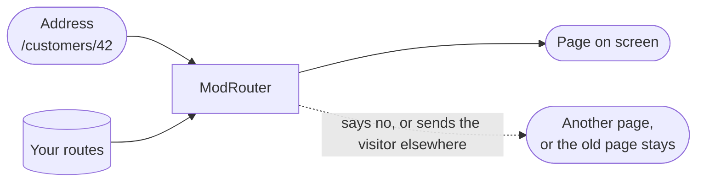
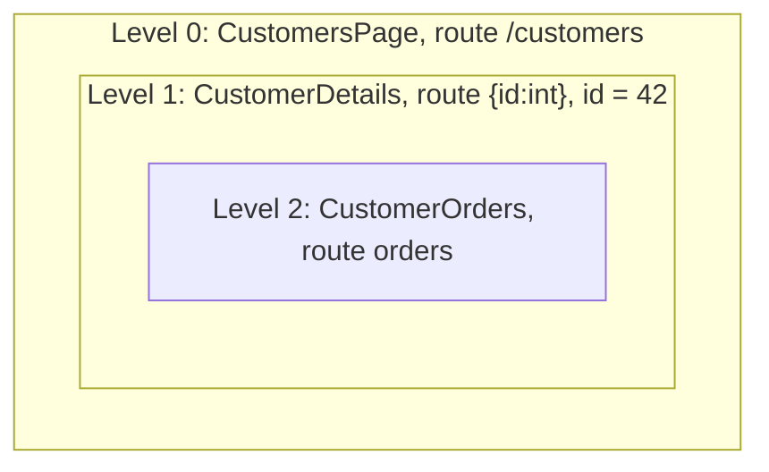
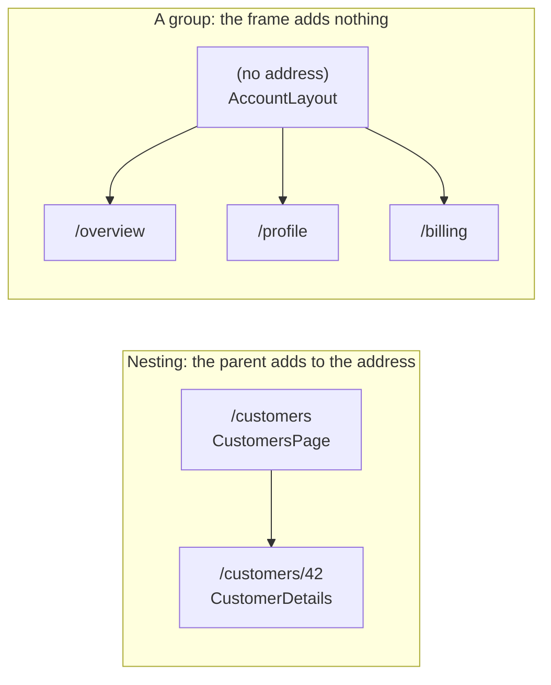
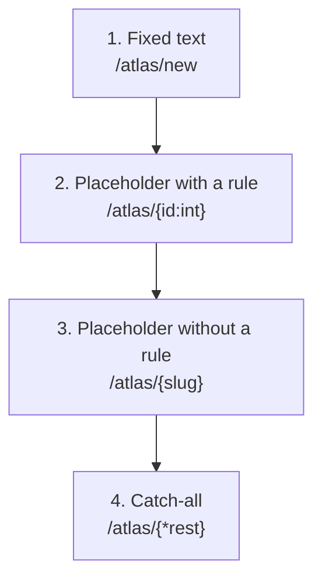
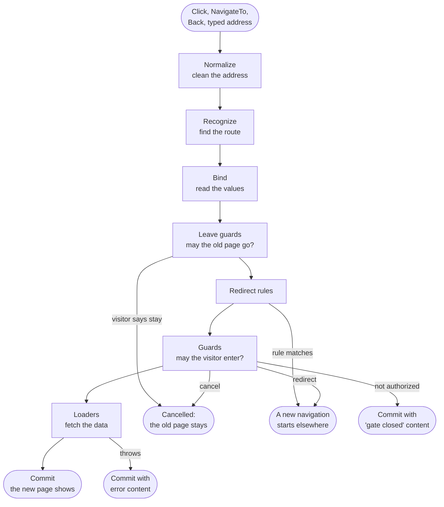
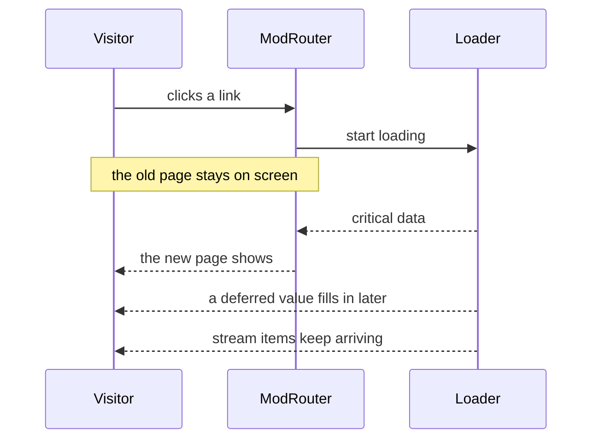
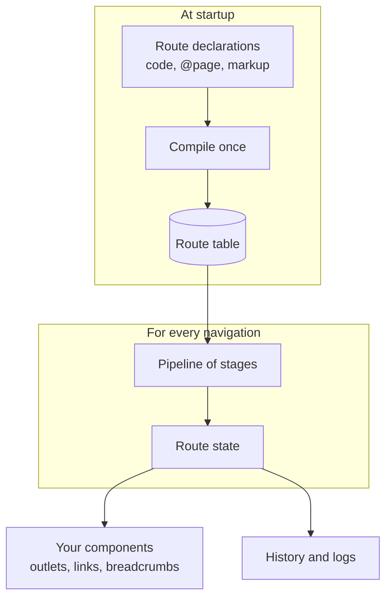

# Concepts

The big picture of ModRouter in plain words, with pictures: what a route is, how an address becomes a page, and what happens during a navigation. Back to the [README](../README.md).

If you would rather click than read, the [interactive lab](https://modrouter.github.io/blazor-modrouter/lab/) shows each idea working, and the [guided lessons](lessons.md) walk through it. Unfamiliar word? See the [glossary](glossary.md).

## The idea in one paragraph

A web address goes in and a page comes out. ModRouter sits in between. It keeps a list of your **routes**, finds the one that matches the address, checks that the visitor may go there, loads the data the page needs, and only then shows the page. Until that moment the old page stays on screen and the address bar does not change, so the visitor never sees a half-finished page.



## Routes and the route table

A **route** says: "an address that looks like this shows this component". It has three parts:

| Part | Example | What it does |
|---|---|---|
| Template | `/customers/{id:int}` | The shape of the address. `{id:int}` is a placeholder that accepts a whole number. |
| Component | `CustomerDetails` | The Blazor component that shows the page. |
| Name | `customer-details` | A label you can use instead of the address. Optional, and very useful. |

All your routes together are the **route table**. ModRouter builds it once, when the app starts. If two routes cannot be told apart, or a name is used twice, the app stops at startup with a code and a message, not later in front of a visitor.

You can declare routes in code, on the pages themselves with `@page`, in markup, or all three. They all end up in the same table. See [Route sources](route-sources.md).

## Pages inside pages

Routes nest. A route can have **children**, and a child shows inside its parent at a spot the parent chooses, called an **outlet**. This is how a ship page can live inside a fleet page, which lives inside a lesson page.

For the address `/customers/42/orders`, three routes match, one inside the next. That list of matches is the **chain**, and each match is a **level** of it:



Each level is a component. The parent places a `<ModRouterOutlet />` where the next level should appear. When only the child changes (the visitor opens a different tab of the same customer), the parent is **not rebuilt**. It stays on screen, keeps its state, and is updated in place. [Lesson 1](lessons/01-pages-inside-pages.md) lets you watch this happen.

Layouts work the same way. A layout is just a component with an outlet. To share one between routes whose addresses have no common start, use a **group**, described next.

## Groups: a shared frame with no address of its own

Nesting shares a frame because the child's address starts with the parent's: `/customers` is the frame, `/customers/42` is inside it. But some pages belong in the same frame without sharing a start. An account area might hold `/overview`, `/profile` and `/billing`. There is no `/account` in those addresses and you do not want one.

A **group** is a route level that has no address. It holds a component (usually a layout with a `<ModRouterOutlet />`) and a set of routes. Those routes keep their own addresses, and the group's component wraps whichever one is showing:

```csharp
routes
    .Route("/", typeof(Home), name: "home")
    .Group(typeof(AccountLayout), account => account
        .Route("overview", typeof(AccountOverview), name: "account")   // /overview
        .Route("profile", typeof(Profile), name: "profile")            // /profile
        .Route("billing", typeof(Billing), name: "billing"))           // /billing
    .Guard<SignedInGuard>();                                           // covers all three
```



What a group does and does not do:

| A group | Details |
|---|---|
| Is a level of the chain | For `/profile` the chain is two levels: the group (`AccountLayout`), then `Profile`. The layout places the page where its outlet is. |
| Keeps its layout alive | Going from `/overview` to `/billing` changes only the deepest level. `AccountLayout` is updated, not rebuilt, exactly like a parent when only its child changes. |
| Shares more than a layout | A guard or a loader declared on the group runs for every route inside it. One `SignedInGuard` protects all three pages. |
| Adds nothing to addresses | The children's templates are relative (no leading `/`). The group itself is never matched, so it has no address, name, alias or title. Breadcrumbs and document titles skip it. |
| Can hold a default page | An index route inside a group is the default page of the group's *parent* path, shown inside the group's layout. |

### The problem a group solves

Without groups you have two choices, and both are poor:

1. **Nest the pages under a made-up parent.** The frame is shared, but the address grows a segment you did not want: `/account/overview` instead of `/overview`. If the addresses are already public or bookmarked, you cannot change them.
2. **Repeat yourself.** Each page declares the same `@layout` and the same check, and each loads the same shared data. The copies drift apart: someone adds a fourth page and forgets the guard, and that page is open to everyone.

A group declares the shared part once, and every route inside gets it, including pages added later.

### When to use a group

Use one when **pages share something but not the start of their address**:

- A signed-in area (`/overview`, `/profile`, `/billing`) behind one layout and one guard.
- A console or admin shell around unrelated top-level addresses.
- A multi-step flow that needs a common frame and a guard such as "the cart must not be empty".
- Pages that all need the same data, such as the current user, loaded once by a group loader instead of in every page.

Do not use one when:

- The pages already share an address start (`/customers`, `/customers/42`). Nest them: the parent's address is the shared part.
- Only one page needs the layout or guard. Declare it on that route.
- You want the shared area to have an address of its own. Use a parent route, which a group cannot be.

A rule of thumb: if the addresses share a start, nest. If they do not and you still want a common frame, guard or loader, use a group.

### Two things to watch

- A guard on a group runs for every route in it, so its redirect target must not be inside the group, or the redirect is guarded too and loops.
- An index route inside a group is the default page of the group's *parent* path, not of the group. Adding one changes what that parent path shows.

[Lesson 7](lessons/07-shared-layouts-and-side-panels.md) shows a group live. [Routing](routing.md#pathless-groups-and-named-outlets) has the full rules, including the markup form and named outlets.

## How the router picks a route

Many routes can fit one address. The router ranks them, and the order never depends on the order you declared them in:



The address `/atlas/42` fits routes 2, 3 and 4. Route 2 wins because a rule is more specific than no rule. The address `/atlas/andromeda` fails the `int` rule, so route 3 wins. You can ask the router to explain any decision with `Explain`, and [Lesson 3](lessons/03-which-route-wins.md) draws that explanation as a ladder.

## One path for every navigation

A click on a link, a call to `NavigateTo`, the Back button and a typed address all go through the same steps, called the **pipeline**. Each step is a **stage**:



The new page is shown only at the last step. This is the **commit**. Everything before it happens while the old page is still visible, and a newer navigation can cancel an older one at any point, so an old answer can never overwrite a newer page.

## Gates: guards, leave guards and redirects

- A **guard** is a small class that answers one question before a page appears: may this visitor go on? It can allow, cancel, redirect, or say "not authorized".
- A **leave guard** is asked before the page that is on screen goes away. It is how you ask "you have unsaved changes, leave anyway?".
- A **redirect rule** forwards one address to another route. It needs no component.

[Lesson 4](lessons/04-gates.md) and [Lesson 6](lessons/06-are-you-sure.md) cover them.

## Data: loaders

A **loader** fetches the data a page needs before the page shows. A loader's answer can have three parts, and each one behaves differently:



- **Critical data** is awaited. The page does not appear without it.
- A **deferred value** arrives after the page is shown. The page shows a placeholder until then.
- A **stream** is a sequence of items that keeps arriving, such as live readings.

Plain critical data can also be **cached**: it stays fresh for a while, is then shown instantly while a refresh runs in the background, and finally expires. See [Lesson 5](lessons/05-data-in-flight.md).

## What the router remembers

After every commit the router publishes its **route state**: the address, the chain of matched levels, the page title, how the navigation began, and any error. Your components can read it and react to changes through `INavigationService`. The router also keeps a short history of finished navigations (which stage ran, how long, how it ended) that the [flight recorder lesson](lessons/09-the-flight-recorder.md) draws.

## Pages that stay alive, and fades

Normally a page is thrown away when the visitor leaves it. A route can ask the router to **keep it alive**: the page stays in memory, hidden, with its state, and returns exactly as it was. The router can also cross-fade between pages with the browser's view transitions. See [Lesson 8](lessons/08-pages-that-stay-alive.md).

## How the pieces fit



## Where to go next

- Try it: [Getting started](getting-started.md), then the [guided lessons](lessons.md).
- Compare it with the built-in router: [Why ModRouter](why-modrouter.md).
- Look something up: [Routing](routing.md) for matching and addresses, [Navigation](navigation.md) for guards, loaders and links.
